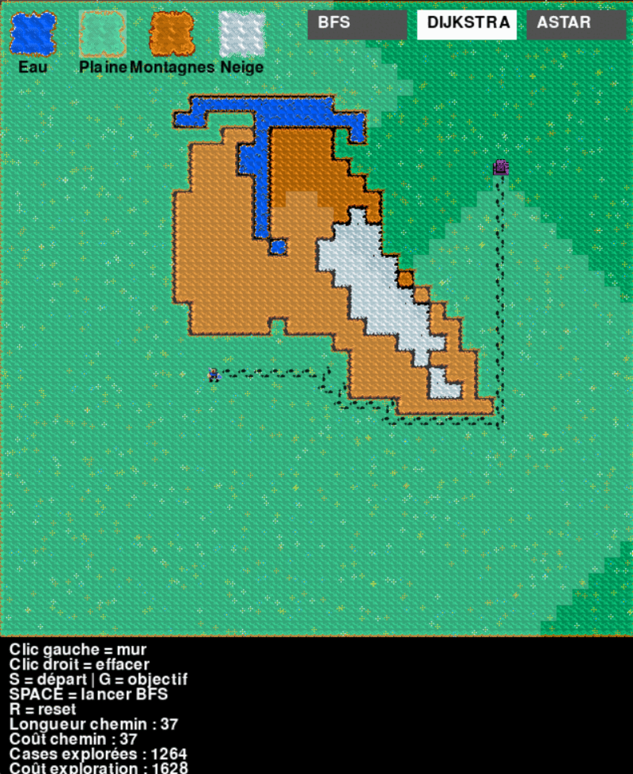
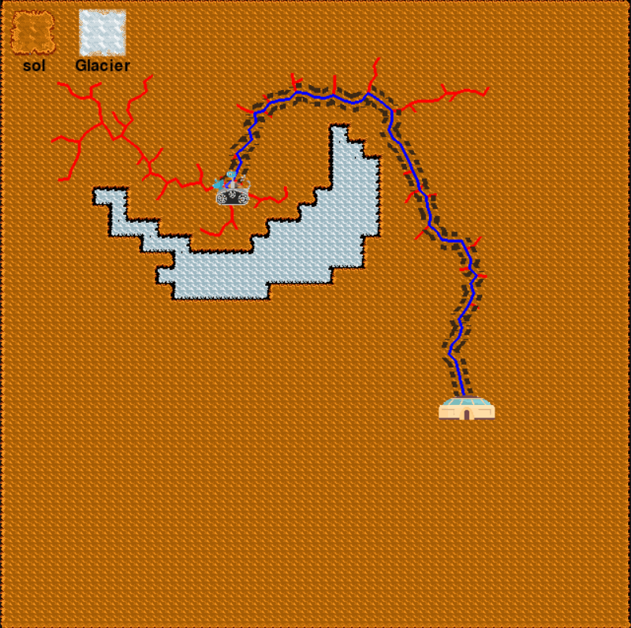
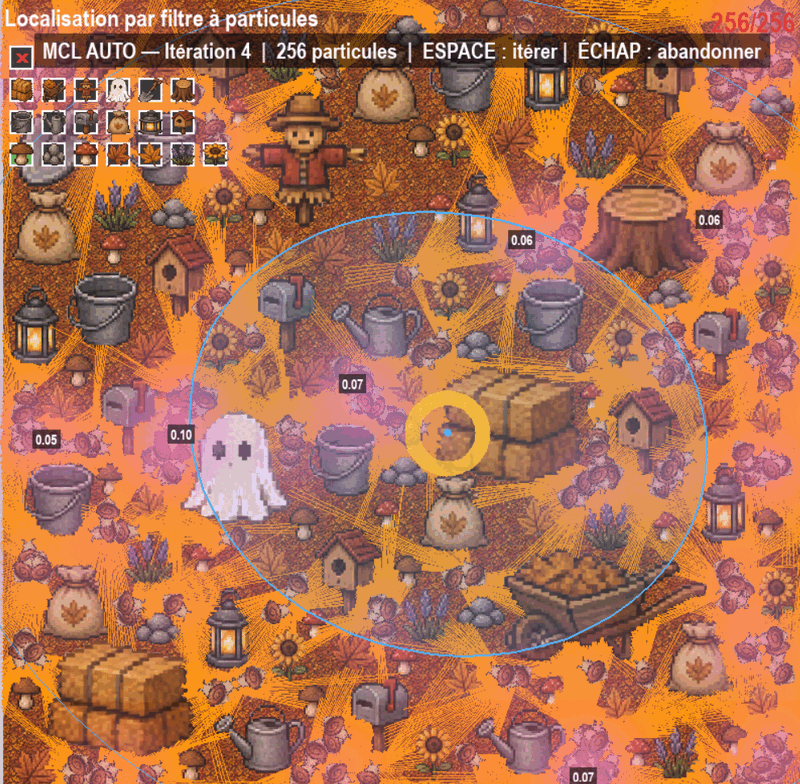
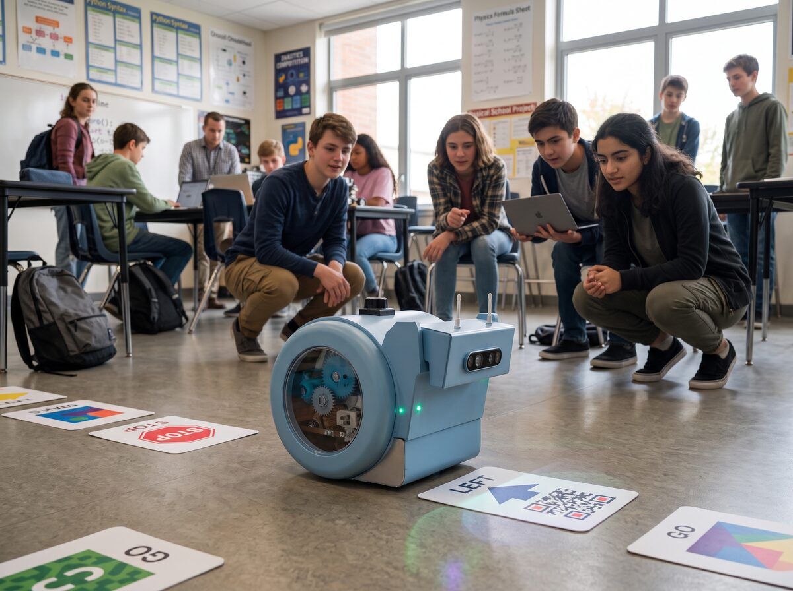

# Les ateliers

Chaque atelier explore **un algorithme réel de la robotique et de l'IA**, à travers un logiciel dédié que les élèves manipulent eux-mêmes. L'enseignant ou le référent dispose d'une feuille de route pas à pas ; aucun prérequis en robotique n'est nécessaire.

## Recherche de chemin

-   

    **Le chemin le plus court** · 9–12 ans · 1 h à 1 h 30

    Les élèves dessinent leur propre carte — eau, plaine, montagnes, neige — puis regardent trois algorithmes rivaliser pour trouver le meilleur chemin.

    *Algorithmes : BFS, Dijkstra, A\**

-   

    **Mission sur Mars** · 9–12 ans · 45 min

    Un rover, un glacier, une base à rejoindre : comment chercher un chemin quand le terrain n'est plus découpé en cases ?

    *Algorithme : RRT (espace continu)*

## Apprentissage et évolution

-   **L'escargot et la pomme** · 13–15 ans · 1 h 30

    Dans le Simulateur Escargot, un escargot virtuel apprend **seul** à atteindre une pomme — un comportement que personne ne lui a programmé.

    *Algorithmes : apprentissage par renforcement — DDQN, PPO, SAC*

-   **Des escargots qui évoluent** · 13–15 ans · 1 h

    Même tâche, méthode radicalement différente : une population d'escargots s'améliore de génération en génération.

    *Algorithme : algorithmes génétiques*

## Localisation et vision

-   

    **Le robot fantôme** · 16–17 ans

    Un robot perdu sur une carte construite par les élèves retrouve sa position grâce à un nuage de particules qui se resserre à chaque observation.

    *Algorithme : localisation de Monte-Carlo (filtre à particules)*

-   **Lire l'écriture à la main** · 16–17 ans · 3 × 1 h 30

    Du premier neurone au réseau convolutif : les élèves entraînent un réseau à reconnaître des chiffres manuscrits, puis ouvrent la boîte noire.

    *Algorithmes : MLP, CNN, ResNet (notebooks Jupyter, base MNIST)*

## En préparation — sur le robot snAIl

Les prochains ateliers quittent le simulateur pour le robot lui-même : ci-dessus, snAIl navigue en classe en lisant des cartes posées au sol avec sa caméra.

-   **Cartographier au laser** · *en préparation*

    Balayer la pièce avec le LiDAR de snAIl et construire, en vrai, la carte que le robot utilisera ensuite pour planifier ses trajets.

    *Capteur : LiDAR*

-   **Voir en relief** · *en préparation*

    Deux objectifs, une profondeur : mesurer les distances avec la caméra 3D stéréo de snAIl, comme le fait une paire d'yeux.

    *Capteur : caméra 3D stéréo*

-   **Parler au robot** · *en préparation*

    Commander snAIl à la voix et découvrir les modèles qui relient voir, comprendre et agir — directement à bord du robot.

    *IA embarquée : voix, petits modèles de langage (SLM), modèles vision-langage-action (VLA)*

---

Chaque atelier existant s'appuie sur un support pédagogique complet (feuille de route pour l'enseignant, lexique, questions de fin de cours). Pour l'organisation d'une séance, voir les [leçons](../lecons/index.md).
