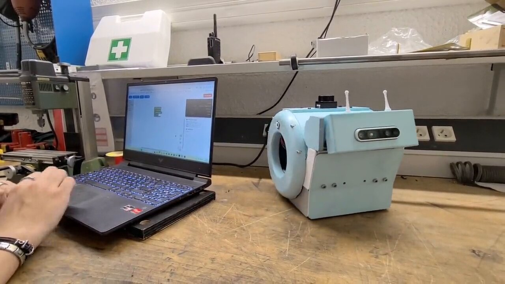

# snAIl — le robot qui apprend aux jeunes la robotique et l'IA

{ width="560" align=right }

**snAIl** est un robot éducatif en forme d'escargot, conçu pour apprendre aux jeunes de **8 à 17 ans** quatre compétences d'avenir :

- le **contrôle de robot** ;
- l'**intelligence artificielle** (embarquée sur le robot) ;
- la **vision par ordinateur** ;
- la **planification de trajectoire**.

Le projet est porté par une **association à but non lucratif** (en cours de création), pour que le coût ne soit jamais une barrière entre un jeune et la robotique.

## Deux parcours, un seul robot

| Parcours | Âge | Langage |
|---|---|---|
| **Blocs visuels** | 8–12 ans | Blocs à emboîter, dans l'esprit de Scratch |
| **Python** | 13–17 ans | Vrai Python, le langage de la recherche en IA |

Les compétences s'empilent étape par étape : **piloter → capter → voir → planifier → décider**. La destination de chaque parcours est l'**autonomie** : un robot qui perçoit, décide et agit seul, grâce au code des élèves.

## Le robot en action

<video controls preload="metadata" style="width:100%;max-width:960px;border-radius:12px" src="/assets/video/robot-en-action.mp4">
Votre navigateur ne peut pas lire cette vidéo.
</video>

## Pour les enseignants

Nous développons des **[leçons clés en main](lecons/index.md)**, publiées sur ce site : objectifs, matériel et déroulé pas à pas, pour préparer chaque séance à l'avance et la mener en classe avec le robot.

Découvrez le **[catalogue des ateliers](ateliers/index.md)** : recherche de chemin, apprentissage par renforcement, algorithmes génétiques, localisation, reconnaissance de chiffres — et bientôt LiDAR, vision 3D et IA vocale sur le robot.

## Contact

Nizar Ouarti · porteur du projet
[nizar.ouarti@sorbonne-universite.fr](mailto:nizar.ouarti@sorbonne-universite.fr) · +33 6 64 87 32 42
