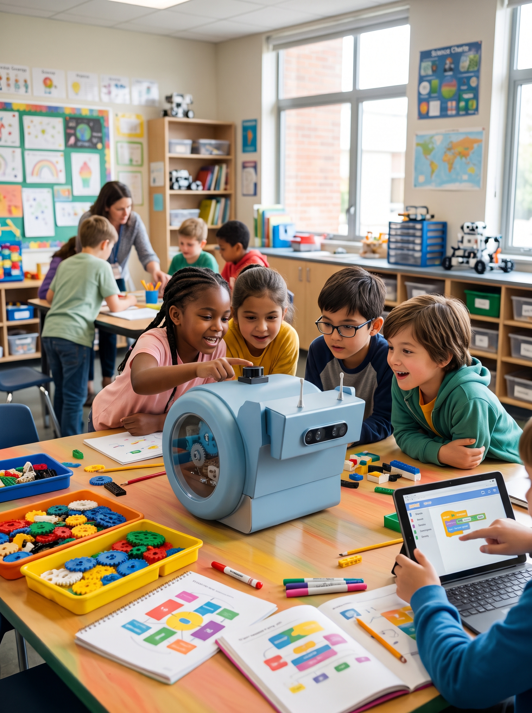

# Lesson B1 — Discovery: make snAIl move

{ width="380" align=right }

| | |
|---|---|
| **Track** | Blocks (ages 8–12) |
| **Duration** | 1 h |
| **Group size** | 3–4 students per robot |
| **Prerequisites** | None |

## Objectives

By the end of the session, students can:

- [ ] connect the tablet or computer to the robot's Wi-Fi hotspot;
- [ ] assemble a sequence of "move", "turn" and "wait" blocks;
- [ ] predict the robot's path before running the program;
- [ ] explain the difference between **translation** and **rotation**.

## Materials

- 1 charged snAIl robot per group;
- 1 tablet or computer per group, with the blocks interface;
- a clear space of about 2 m × 2 m per robot;
- colored tape to mark a course on the floor.

## Session plan

### 1. Who is snAIl? (10 min)

Introduce the robot: its special wheel that lets it move forward **and** spin in place, its "eyes" (the camera), its antennas. Ask the students: *"How do you tell a robot what to do?"*

### 2. Connecting (10 min)

Each group connects its tablet to the robot's Wi-Fi (the robot creates its own network — show its name). Check that the blocks interface shows "robot connected".

### 3. First program (20 min)

Students assemble their first sequence:

```text
when [flag] clicked
  move forward 50 cm
  turn 90°
  move forward 50 cm
```

**Golden rule: predict before you run.** Each group draws the expected path on paper, then runs the program and compares.

### 4. Challenge: the square (15 min)

Challenge: make the robot drive a **full square** and return to its starting point. Fast groups try the triangle (hint: the angle is no longer 90°).

### 5. Wrap-up (5 min)

Each group shows its course. Questions: *"What surprised you?"*, *"What would you do differently?"*

## Going further

Add a block "if the bumper is touched, stop": a first encounter with **sensors**, the topic of lesson B2.

!!! note "For the teacher"
    The exact blocks depend on the interface version; adapt the screenshots and block names to your setup. The plan and objectives stay the same.
