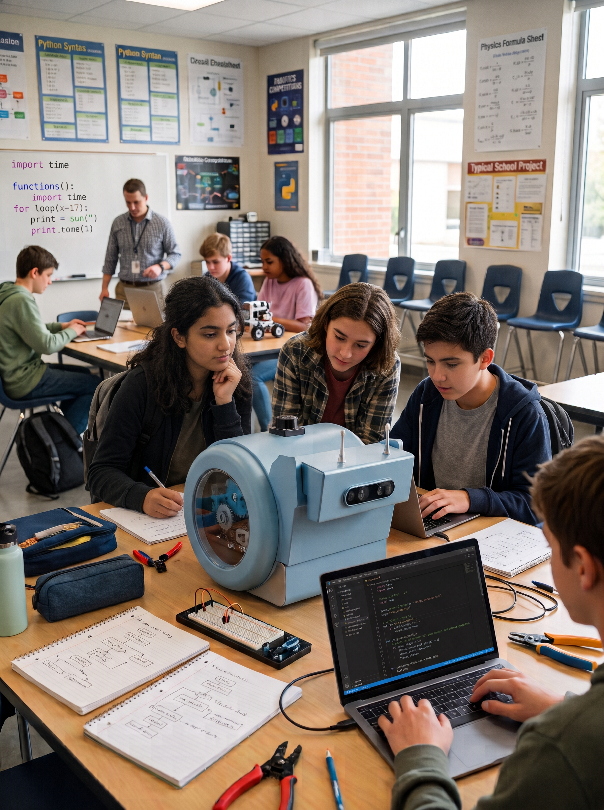

# Lesson P1 — First steps in Python with snAIl

{ width="380" align=right }

| | |
|---|---|
| **Track** | Python (ages 13–17) |
| **Duration** | 1 h 30 |
| **Group size** | Pairs, 1 robot per 2–3 pairs |
| **Prerequisites** | Python basics (variables, loops) |

## Objectives

By the end of the session, students can:

- [ ] connect to the robot from Python through its Wi-Fi hotspot;
- [ ] command a translation and a rotation;
- [ ] read an ultrasonic distance measurement;
- [ ] write a loop "move forward while the way is clear".

## Materials

- 1 charged snAIl robot per 2–3 pairs (rotate turns);
- 1 computer per pair with Python 3 and the snAIl library installed;
- one obstacle (cardboard box) per station.

## Session plan

### 1. From blocks to code (10 min)

A reminder for those coming from the blocks track: each block maps to a line of code. Show a block program and its Python equivalent side by side.

### 2. Connecting and first script (25 min)

Connect the computer to the robot's Wi-Fi, then:

```python
from snail import Robot

robot = Robot()          # connects through the hotspot
robot.forward(0.5)       # translation: 50 cm
robot.turn(90)           # rotation: 90 degrees
robot.forward(0.5)
```

Each pair changes the values and observes. **Predict before you run**, just like in the blocks track.

### 3. Reading a sensor (20 min)

```python
distance = robot.ultrasonic()   # distance to the obstacle, in meters
print(f"Obstacle at {distance:.2f} m")
```

Measure the distance to a box, move it closer, measure again. Discussion: accuracy, limits of the sensor.

### 4. Challenge: stop before the obstacle (25 min)

Write a loop that moves the robot forward **while** the way is clear, and stops it 20 cm from the obstacle:

```python
while robot.ultrasonic() > 0.20:
    robot.step_forward()
robot.stop()
```

Fast pairs: drive around the obstacle (turn, move, turn back).

### 5. Wrap-up (10 min)

Demos. Opening question: *"What if the robot used its 3D camera instead of the ultrasonics?"* — that is the topic of the vision lessons.

!!! note "For the teacher"
    The function names (`forward`, `turn`, `ultrasonic`…) must be adapted to the real snAIl library API; the structure of the session stays the same.
